# 🔐 CryptoLab — Cryptography and Network Security Practical Implementation


A polished portfolio of **14 laboratory experiments** for the **Cryptography and Network Security** course (CSL0509). It covers classical ciphers, modern symmetric and asymmetric cryptography, hashing, digital signatures, X.509 certificates, Python implementations, network traffic analysis, password security and SSH authentication.

---

## 📑 Table of Contents

- [Student Information](#-student-information)
- [About the Project](#-about-the-project)
- [Project Objectives](#-project-objectives)
- [Course Learning Outcomes](#-course-learning-outcomes)
- [Bloom's Taxonomy Levels](#-blooms-taxonomy-levels-covered)
- [Practical Experiments](#-practical-experiments)
- [Technologies and Tools](#-technologies-and-tools)
- [Concepts Covered](#-concepts-covered)
- [Repository Structure](#-repository-structure)
- [Getting Started](#-getting-started)
- [Experiment Documentation and Evidence](#-experiment-documentation-and-evidence)
- [Screenshot Gallery](#-screenshot-gallery)
- [Assessment and Marks Distribution](#-assessment-and-marks-distribution)
- [Learning Outcomes](#-learning-outcomes)
- [Future Scope](#-future-scope)
- [Academic Disclaimer](#-academic-disclaimer)
- [Author](#-author)

---

## 👤 Student Information

| Field | Details |
|---|---|
| Name | Tejshvini Yerpurwad |
| Roll Number | BETN1AI24043 |
| Programme | B.Tech Artificial Intelligence and Machine Learning |
| Semester | V |
| Section | D |
| University | ITM University, Gwalior |
| Course | Cryptography |
| Course Code | CSL0509 |
| Faculty | Mr. Hirendra Singh Sengar |
| Academic Year | 2026–27 |

---

## 📖 About the Project

CryptoLab is an academic project developed to explore the fundamental concepts and practical applications of cryptography and network security. The repository consists of 14 experiments covering classical encryption techniques, modern cryptographic algorithms, hashing, digital signatures, digital certificates, network traffic analysis, password security and secure authentication. Each experiment focuses on understanding the underlying concepts through implementation, execution and observation using industry-relevant tools and technologies.

## 🎯 Project Objectives

- Study classical encryption techniques and their applications.
- Understand symmetric and asymmetric cryptographic algorithms.
- Implement and analyze RSA and Diffie–Hellman algorithms.
- Perform data hashing and digital signature verification.
- Generate and examine X.509 digital certificates.
- Understand HTTPS communication and TLS handshakes.
- Analyze encrypted and unencrypted network traffic.
- Identify secure and insecure communication protocols.
- Explore password security and auditing techniques.
- Configure SSH key-based authentication between Linux systems.

## 🎓 Course Learning Outcomes

- Apply cryptographic algorithms to protect data.
- Analyse network traffic and security protocols.
- Evaluate password and authentication mechanisms.
- Configure and verify secure communication systems.

## 🧠 Bloom's Taxonomy Levels Covered

- **BL3 – Apply:** Experiments 4, 5, 7, 8, 14
- **BL4 – Analyze:** Experiments 1, 2, 3, 6, 9, 10, 11, 12, 13

---

## 🧪 Practical Experiments

| No. | Experiment Title | Tools / Technologies |
|---|---|---|
| 01 | Implementation of Caesar, Vigenère and Rail Fence Ciphers | CrypTool |
| 02 | Frequency Analysis of Classical Ciphers | CrypTool |
| 03 | Comparative Study of DES and AES Encryption | CrypTool |
| 04 | RSA Key Generation and File Encryption/Decryption | OpenSSL |
| 05 | SHA-256 Hashing and RSA Digital Signature Verification | OpenSSL |
| 06 | Generation and Inspection of Self-Signed X.509 Certificates | OpenSSL |
| 07 | Implementation of RSA and Diffie–Hellman Algorithms | VS Code |
| 08 | AES Encryption and SHA-256 Hashing | VS Code |
| 09 | Password Hashing With and Without Salt | VS Code |
| 10 | HTTPS Traffic Capture and TLS Handshake Analysis | Wireshark |
| 11 | Analysis of Encrypted VPN Traffic | Wireshark |
| 12 | Identification of Secure and Insecure Communication Protocols | Wireshark |
| 13 | Password Auditing and Password Strength Evaluation | Kali Linux, John the Ripper |
| 14 | SSH/RSA Key Generation and Passwordless Authentication | Kali Linux, OpenSSH |

---

## 🛠️ Technologies and Tools

| Technology | Purpose |
|---|---|
| Python | Implementation of cryptographic algorithms |
| CrypTool | Classical and modern cryptography experiments |
| OpenSSL | Encryption, hashing, RSA keys and certificates |
| Wireshark | Network packet capture and protocol analysis |
| Kali Linux | Security testing and Linux-based experiments |
| John the Ripper | Password auditing |
| OpenSSH | Secure remote authentication |
| Windows / Linux | Experiment execution environments |

---

## 🧠 Concepts Covered

### 1. Cryptographic Algorithms
- Classical substitution and transposition ciphers
- Symmetric encryption: DES and AES
- Asymmetric encryption: RSA
- Diffie–Hellman key exchange

### 2. Data Integrity and Authentication
- SHA-256 hashing
- Password hashing and salting
- RSA digital signatures
- X.509 digital certificates

### 3. Network Security
- HTTPS communication
- TLS handshake analysis
- VPN encryption
- Secure and insecure protocols
- Network packet inspection

### 4. System Security
- Password auditing
- SSH key generation
- Public-key authentication
- Passwordless remote login

---

## 📁 Repository Structure

```
Cryptography-Practical-File/
│
├── Exp1_Caesar_Vigenere_RailFence/
├── Exp2_FrequencyAnalysis/
├── Exp3_DES_AES/
├── Exp4_RSA_OpenSSL/
├── Exp5_SHA256_DigitalSignature/
├── Exp6_X509_Certificate/
├── Exp7_RSA_DiffieHellman/
├── Exp8_AES_SHA256_MessageSecurity/
├── Exp9_PasswordHashing_Salting/
├── Exp10_HTTPS_TLS_Wireshark/
├── Exp11_VPN_Traffic_Analysis/
├── Exp12_Secure_Insecure_Protocols/
├── Exp13_JohnTheRipper_PasswordAudit/
├── Exp14_SSH_Passwordless_Authentication/
│
├── README.md
├── SCREENSHOT_GUIDE.md
├── FINAL_SUBMISSION_CHECKLIST.md
├── EXPERIMENT_COMPLETION_CHECKLIST.md
├── requirements.txt
└── .gitignore
```

Each experiment folder contains the corresponding practical work and its related files.

---

## 🚀 Getting Started

### Prerequisites

Install the required tools depending on the experiment you want to execute:

- Python 3.x
- CrypTool / CrypTool 2
- OpenSSL
- Wireshark
- Kali Linux
- John the Ripper
- OpenSSH
- Windows / Linux

### Clone the Repository

```bash
git clone https://github.com/tejshveeyerpurwad-hash/Cryptography-Practical-File.git
```

### Navigate to the Project Directory

```bash
cd Cryptography-Practical-File
```

### Check Tool Installation

```bash
python --version
openssl version
ssh -V
```

Open the respective experiment directory and follow the instructions and files provided for that practical.

---

## 📸 Experiment Documentation and Evidence

Each experiment documents: aim, theory, requirements, algorithm, procedure, commands/code, output and observations, result and conclusion, and screenshot references. Actual screenshots and outputs must be genuine.

---

## 📸 Screenshot Gallery

Screenshots are referenced from each experiment's `Screenshots/` folder. Visual content must be verified manually before submission.

<details><summary>Exp1_Caesar_Vigenere_RailFence</summary>


</details>

<details><summary>Exp2_FrequencyAnalysis</summary>


</details>

<details><summary>Exp3_DES_AES</summary>


</details>

<details><summary>Exp4_RSA_OpenSSL</summary>

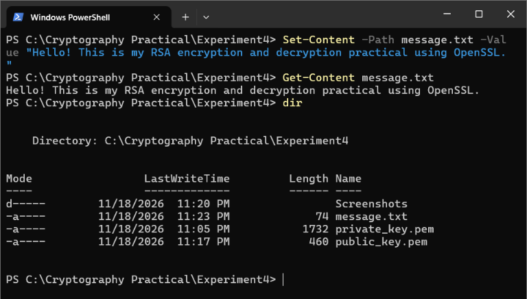


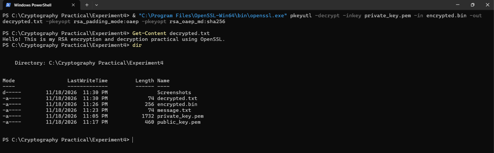


</details>

<details><summary>Exp5_SHA256_DigitalSignature</summary>


</details>

<details><summary>Exp6_X509_Certificate</summary>

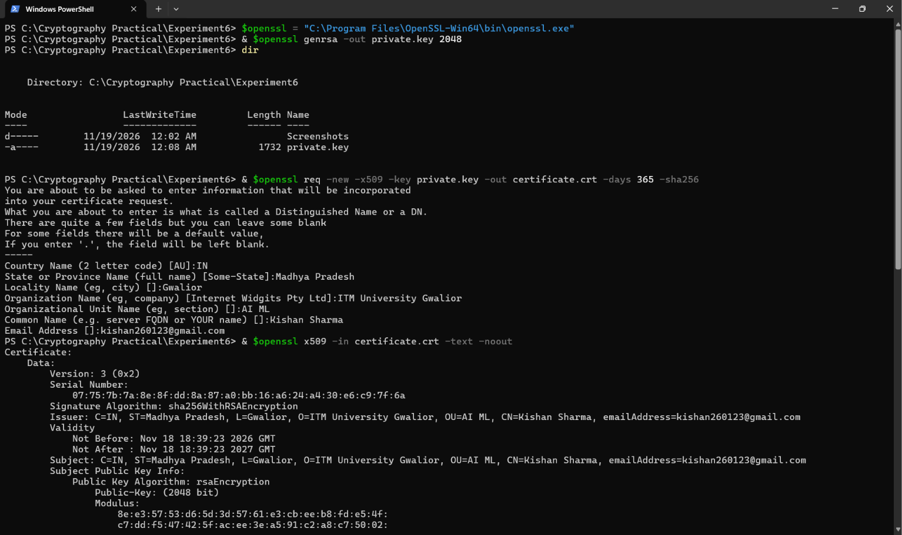

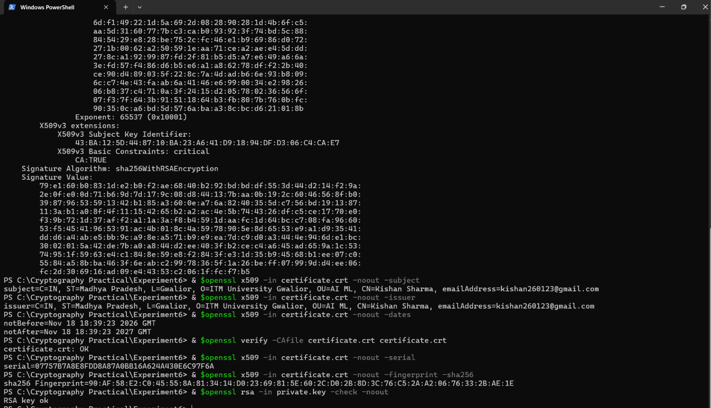

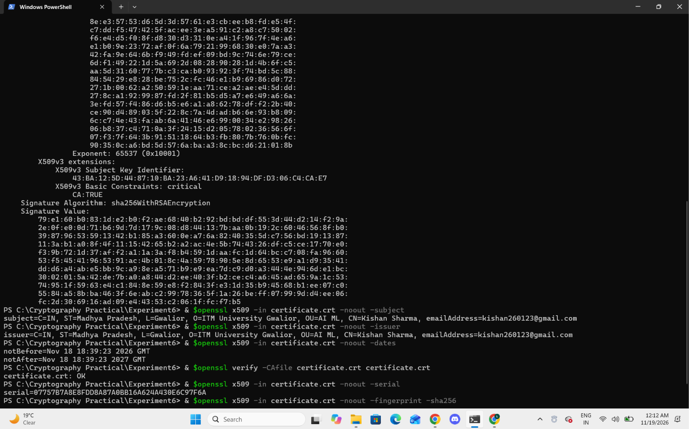

</details>

<details><summary>Exp7_RSA_DiffieHellman</summary>

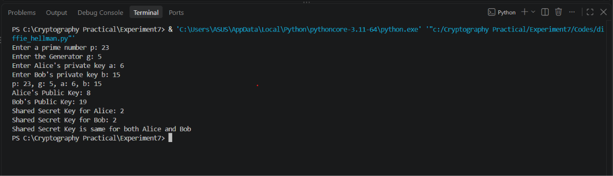


</details>

<details><summary>Exp8_AES_SHA256_MessageSecurity</summary>


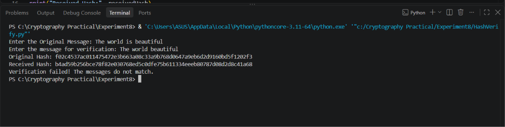

</details>

<details><summary>Exp9_PasswordHashing_Salting</summary>

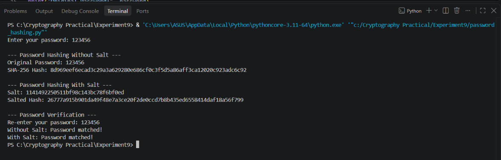

</details>

<details><summary>Exp10_HTTPS_TLS_Wireshark</summary>


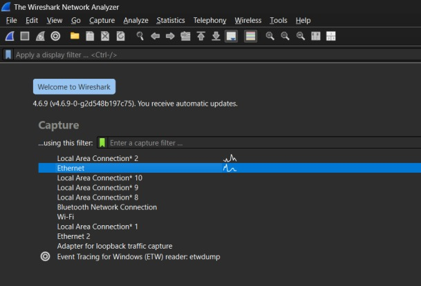


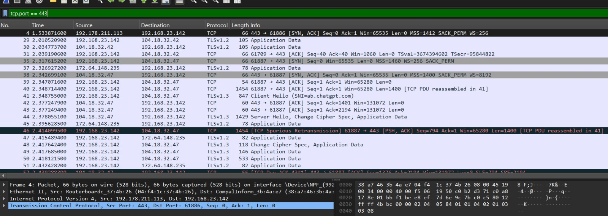

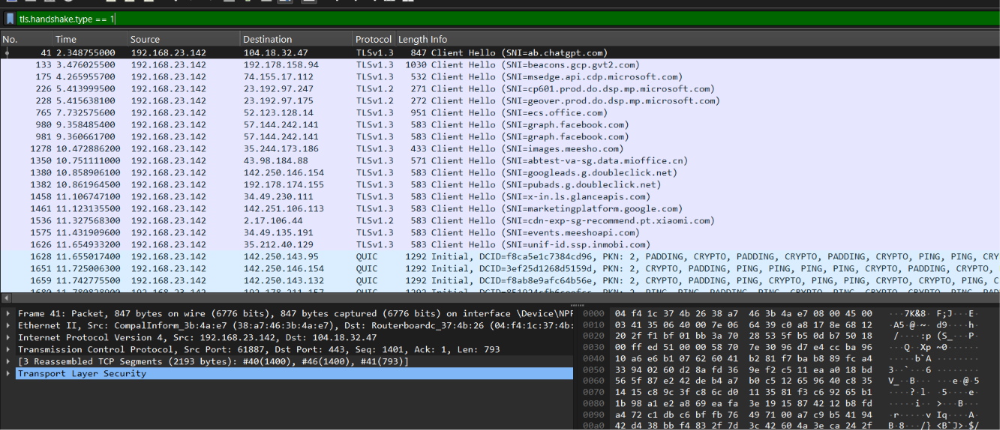


</details>

<details><summary>Exp11_VPN_Traffic_Analysis</summary>


</details>

<details><summary>Exp12_Secure_Insecure_Protocols</summary>


</details>

<details><summary>Exp13_JohnTheRipper_PasswordAudit</summary>

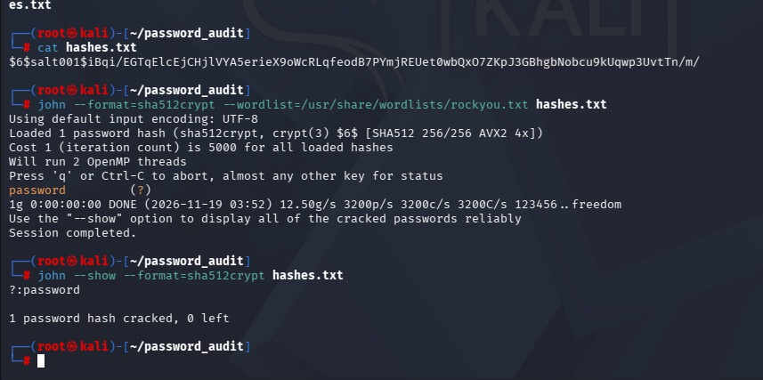

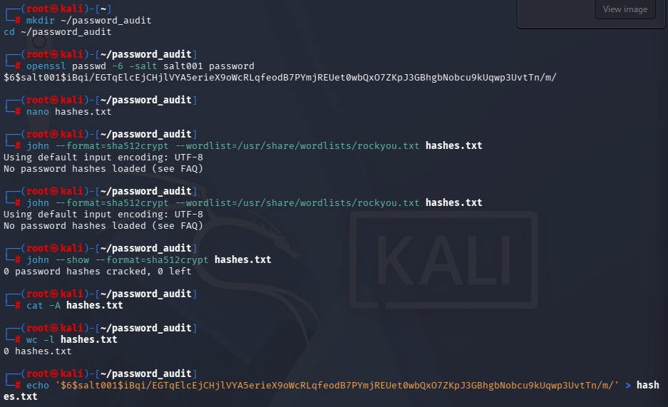

</details>

<details><summary>Exp14_SSH_Passwordless_Authentication</summary>


</details>

---

## 📊 Assessment and Marks Distribution

- Lab Experiments (GitHub Deployment – Problem Statements): **40 marks**
- **Total: 40 marks**

---

## 🎓 Learning Outcomes

Through these experiments, the project provides practical exposure to:

- Encryption and decryption techniques.
- Cryptographic key generation and management.
- Data integrity and authentication mechanisms.
- Secure network communication.
- Packet capture and traffic analysis.
- Password security assessment.
- Linux-based authentication mechanisms.

---

## 🔮 Future Scope

The concepts explored in this repository provide a foundation for further study in areas such as:

- Ethical Hacking and Penetration Testing
- Network Security and Monitoring
- Web Application Security
- OWASP Top 10
- Digital Forensics
- Vulnerability Assessment
- Security Automation using Python

---

## ⚠️ Academic Disclaimer

This repository has been created for academic and educational purposes as part of practical coursework.

All experiments involving network analysis, password auditing, and security testing should only be performed on systems and networks owned by the user or where proper authorization has been obtained.

---

## 👤 Author

**Tejshvini Yerpurwad**

B.Tech — Artificial Intelligence and Machine Learning (AIML)

Cryptography and Network Security — Practical Coursework

GitHub: [tejshveeyerpurwad-hash](https://github.com/tejshveeyerpurwad-hash)

---

*CryptoLab | Learning Cryptography Through Practical Implementation.*
